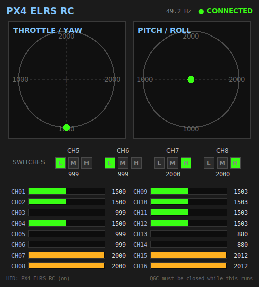

# PX4 ELRS RC Relay + HSRCF405_TF Board Support

**PX4 ELRS RC Relay**: read `RC_CHANNELS` from PX4 over USB MAVLink and expose
them as a Linux virtual gamepad (`PX4 ELRS RC`) for simulators, with a live
GUI monitor. The repo also contains the full PX4 v1.15.3 board support used on
the **HSRCF405_TF** STM32F405 flight controller.



> 用途：把飞控收到的 ELRS/CRSF RC 数据通过 USB MAVLink 转成 Linux 标准虚拟
> 手柄（uinput），直接给穿越机模拟器用；附带 GUI 实时显示摇杆、开关和 16 个
> 通道，以及 HSRCF405_TF 的 PX4 板级支持、编译和 DFU 刷机脚本。

## Quick start (RC relay)

```bash
# Close QGroundControl first (it owns /dev/ttyACM0)
python3 tools/rc_monitor_gui.py      # GUI + virtual gamepad
# or headless:
python3 tools/rc_to_hid.py
```

The virtual device is named `PX4 ELRS RC`; select it in your simulator.
Writing to `/dev/uinput` must be permitted.

## Hardware

- MCU: STM32F405RGT6, 1 MB Flash, 128 KB SRAM + 64 KB CCM, **HSI only (no HSE)**
- IMU: ICM42605 on SPI1 (CS PA4, DRDY PC4)
- Baro: DPS310 on I2C1 (PB8/PB9, 0x76)
- SD card: SPI3 (SCK PC10, MISO PC11, MOSI PB5, CS PA15)
- ADC3: VBAT PC1, current PC3, RSSI PC0
- Motors (8 outputs): M1 PC8 (TIM8_CH3), M2 PC9 (TIM8_CH4), M3 PA8 (TIM1_CH1),
  M4 PA9 (TIM1_CH2), M5 PA10 (TIM1_CH3), M6 PB4 (TIM3_CH1),
  M7 PB0 (TIM3_CH3), M8 PB1 (TIM3_CH4)
- LED strip: PB3 (TIM2_CH2), 4 onboard + external WS2812B; not driven by PX4
- UART1 PB6/PB7, UART2 PA2/PA3, UART3 PB10/PB11, UART4 PA0/PA1,
  UART5 PC12/PD2, UART6 PC6/PC7
- USB FS: PA11/PA12

详细资源文档见 [`docs/HSRCF405_TF_RESOURCES.md`](docs/HSRCF405_TF_RESOURCES.md)，完整引脚对照表（原厂 BF vs PX4、定时器/DMA）见 [`docs/PIN_MAP.md`](docs/PIN_MAP.md)。

## Firmware features

- PX4 v1.15.3, board target `hsrc_f405tf_default`
- HSI 16 MHz → 168 MHz PLL, PLLQ = 48 MHz USB
- Quad X (airframe 4001), DShot600 on TIM8/TIM1/TIM3; 8 PWM outputs available
- ICM42605 (SPI1) + DPS310 (I2C1) + ADC3
- Serial defaults:
  - UART1 = RC (ELRS/CRSF)
  - UART3 = GPS
  - UART6 = MAVLink
  - USB = MAVLink
- No SD logger / no MSP OSD: the F405 RAM is too tight for the full stack
  plus logging/OSD. SD card is still used for params backup/dataman.

## Repository layout

```
boards/hsrc/f405tf/     PX4 board support (copy into PX4-Autopilot/boards/hsrc/)
  default.px4board
  firmware.prototype
  init/                 rc.board_defaults / sensors
  nuttx-config/         NuttX defconfig, board.h, DMA map, linker script
  src/                  board_config.h, init.c, spi/i2c/timer/led/usb
tools/
  rc_to_hid.py          PX4 RC_CHANNELS → Linux virtual gamepad (uinput)
  rc_monitor_gui.py     GUI monitor + optional virtual gamepad
  flash_px4.sh          DFU flash helper
  restore_betaflight.sh Restore a private factory backup
docs/                   pinout/resource notes
firmware/               prebuilt DFU/app/bootloader binaries
betaflight-target/       original Betaflight target config (GPLv3)
```

## Build

Requirements: Ubuntu 22.04, `arm-none-eabi-gcc`, `python3`, `git`, `cmake`,
`ninja`, and the PX4 Python requirements (see PX4 docs).

```bash
./tools/build.sh
```

The script clones PX4-Autopilot v1.15.3 (if missing), initializes submodules,
copies this board into the PX4 tree and builds `hsrc_f405tf_default`. The
result is:

```
$PX4_DIR/build/hsrc_f405tf_default/hsrc_f405tf_default.bin
```

Set `PX4_DIR` to use an existing PX4 tree.

## Flash

Prebuilt images are in [`firmware/`](firmware/):

- `hsrc_f405tf_px4_full_dfu.bin` — bootloader + PX4 app, flash at `0x08000000`
- `hsrc_f405tf_px4_app.bin` — PX4 app only, flash at `0x08008000`
- `px4_bootloader_flywoo.bin` — PX4 F405 bootloader (from PX4 `flywoo/gn-f405`)

Put the board into DFU (hold BOOT0 while plugging USB) and run:

```bash
./tools/flash_px4.sh
```

or manually:

```bash
dfu-util -a 0 -s 0x08000000:leave -D firmware/hsrc_f405tf_px4_full_dfu.bin
```

> The full DFU image erases the parameter sector. On first boot the board
> defaults in `init/rc.board_defaults` are applied.

### Restore Betaflight

The factory full-flash backup is **not** included (it contains the unique MCU
ID). Restore your own private backup:

```bash
./tools/restore_betaflight.sh /path/to/original_firmware_backup.bin
```

## RC → virtual gamepad / GUI

The tools read PX4 `RC_CHANNELS` over USB MAVLink and create a Linux uinput
gamepad named **`PX4 ELRS RC`**:

```bash
python3 tools/rc_monitor_gui.py          # GUI + virtual gamepad
python3 tools/rc_to_hid.py               # headless virtual gamepad
```

Mapping:

| RC | HID |
|---|---|
| ch1 roll | `ABS_X` (−32767..32767) |
| ch2 pitch | `ABS_Y` |
| ch3 throttle | `ABS_Z` (0..32767) |
| ch4 yaw | `ABS_RZ` |
| ch5..ch8 | 8 buttons (low/high per switch) |

Notes:

- Close QGroundControl while these tools run (they own `/dev/ttyACM0`).
- `/dev/uinput` must be writable; the repo does not modify system udev rules.
- GUI options: `--no-hid`, `--invert-pitch`, `--invert-yaw`, `--invert-roll`.

## Before flying

1. Calibrate accel/gyro and RC in QGroundControl.
2. **Remove props** and verify motor order/direction (QGC Actuators test).
3. Calibrate `BAT1_V_DIV` / `BAT1_A_PER_V` (placeholders: 11.2 / 100.0).
4. Confirm IMU orientation (Betaflight CW90 → PX4 `-R 2`). Verify in QGC.
5. If no compass is connected, set `SYS_HAS_MAG=0`.
6. HSI-based USB works but has no crystal-grade accuracy.

## License

- Board support files: BSD-3-Clause (same as PX4).
- Tools in `tools/`: BSD-3-Clause.
- `betaflight-target/config.h`: GPLv3 (from Betaflight).
- Prebuilt bootloader: PX4 / original board vendor, BSD-3-Clause.

See [`LICENSE`](LICENSE) and [`NOTICE`](NOTICE).
